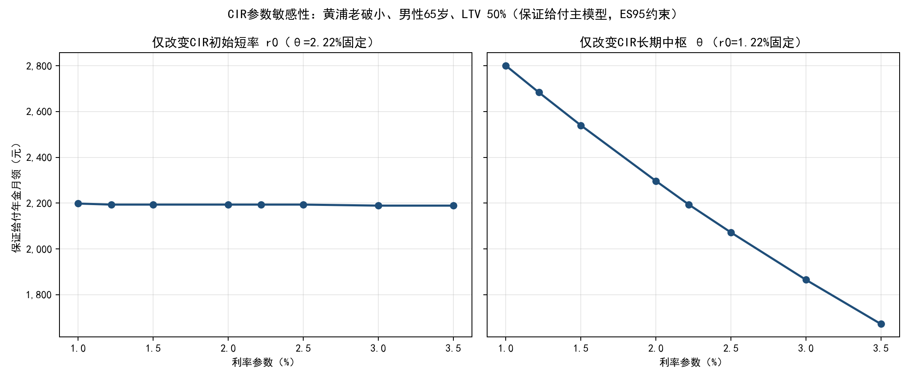
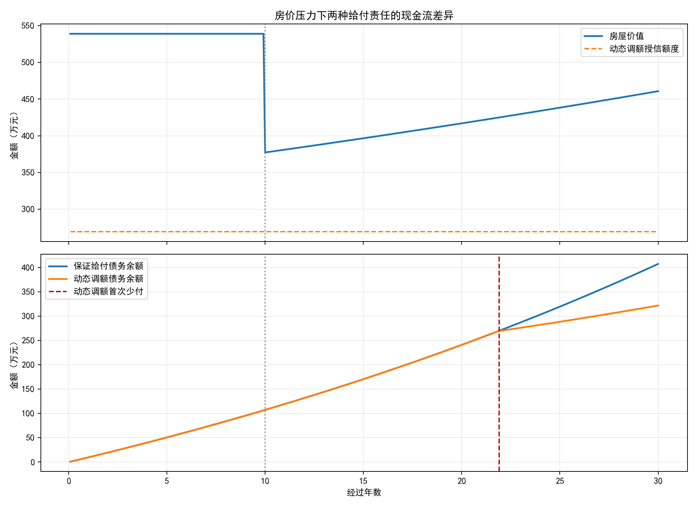

# 双产品体系下保险年金模式的统计精算模型白皮书

> **本文由唯一正本发布，请勿直接编辑。**
> 唯一正本：工作区根目录 `精算模型数据来源与参数-v3-sy-1020.md`（版本号随修订滚动）。
> 本副本仅将文内 2 处图片相对路径改写为仓库内路径（`../model/CL1模型/outputs/figures/`），其余与正本逐字一致。
> 如需修订，请改正本后重新发布，不要在 GitHub 上直接提交本文。

> 版本：v3-sy-1020（专业修订合并版，2026-10-20）
> 定位：大学生创新创业训练计划的统计精算研究原型
> 边界：研究情景，不构成上海信托或任何机构的现行产品、商业报价、法律意见或监管结论
>
> 本版说明：在 0727 版基础上合并"专业修订版"（另一 Agent 修订、经逐条核查采纳）——风险约束由 P95 改为 ES95、房价冲击由 Student-t(df=4) 改为两成分正态混合、合同拆分为"保证给付年金（主模型）+ 动态调额提款（扩展）"、利率敏感性拆分 r0 与 θ；同时补回修订副本中删减的数据溯源、g_H^P 参数治理、HUD PLF 对照、代际传承条款、政策建言章与汇报清单。修订依据详见《房价数据和建模/以房养老_建模全量交接包_专业修订版_20261020.zip/…/04_专业修订说明_给原Agent.md》。

## 一、 研究背景与技术路线

### 1. 研究边界与模式定位（保险年金模式优先）

前期市场调研（详见《市调报告》）表明，受众需求呈两极分化：老年群体偏好"现金+保障"的保险年金型以房养老模式，中年群体更青睐"服务+保障"的养老服务信托模式。

本白皮书的精算模型**专门针对"方案一：保险年金模式"量身定制**，该模式涉及长达 30 年的跨期现金流错配，面临房价暴跌和极端长寿的双重尾部风险；而"方案二：养老服务信托模式"的本质是"实物服务抵扣与资产运营"，其核心壁垒在于康养机构的跨界服务整合能力，而非金融衍生品的风险定价。

上海信托等行业机构可为业务流程、参数和风险分工提供验证，但本研究不预设由信托公司独自提供资金或承担长寿、房价和非追索尾部风险。

### 2. 核心痛点与传统模型的局限性

在长寿时代背景下，我国老年家庭普遍面临资产富裕、现金贫穷的流动性错配问题。信托型以房养老作为一种破局工具，其本质是向老年人提供终身年金，并以房产作为最终清算标的。然而，传统反向抵押贷款定价往往采用**确定性点估计**（如假定房价每年固定上涨 2%、老人按平均预期寿命生存），忽略了金融市场的尾部风险与个体寿命的随机性。一旦发生房地产下行（资产缩水）或极端长寿（负债膨胀），金融机构将面临巨大的**担保不足损失（Shortfall Risk）**。

### 3. 技术路线与模型定位

**技术路线的选择依据**：传统固定复利预测法仅能提供线性外推的乐观预测。在长达 20-30 年的业务周期中，一旦遭遇房地产周期下行或极端长寿风险，金融机构将面临巨大冲击。因此，本研究的核心在于：**将以房养老这一复杂的社会民生问题，转化为严密的随机模拟与尾部风险约束问题**。我们不盲目预测房价具体涨幅，而是通过蒙特卡洛随机抽样覆盖各类极端尾部风险，寻找机构风险可控前提下老人可领取的月领上限。

**模型定位（重要）**：主模型是 **P 测度（物理测度、真实世界）下的蒙特卡洛风险与支付能力模型**，模拟官方 CL1 死亡率下的随机存续期、房价正态混合冲击及漂移情景、CIR 随机利率、月度给付、债务累积、清算价值、非追索短缺和剩余权益。它**不是 Q 测度公允价值模型**：非追索责任在经济上类似机构承担抵押物不足的看跌期权风险，但本研究没有完成风险中性贴现估值，因此不将主模型称为"欧式期权定价"，反解结果对外表述为**"真实世界风险约束下的最大可支付额度"**，不称公允价格。若后续需要非追索保障的公允价值 V=E^Q[e^{−∫r}(D_τ−(1−ψ)H_τ)^+]，须另建 Q 测度估值层，不能沿用 P 测度参数直接输出。

具体技术路线与核心术语的业务翻译如下：

1. **多源数据底座构建**：统筹宏观（CSMAR 面板数据、官方中债国债收益率）、微观（马克数据网/安居客区级房价、一房一万租金回报率、中国房价行情网估值）与最新精算标准（2025 官方 CL1 生命表）。
2. **随机过程建模（三因素联动）**：
   * **房价：GBM 骨架 + 独立漂移 g_H^P + 两成分正态混合肥尾冲击**（数学形式见第三节）；
   * **利率：CIR 模型**，$dr_t = \kappa(\theta - r_t)dt + \sigma_r \sqrt{r_t} dW_t^r$，官方中债数据校准（见第二节）；
   * **长寿：官方 CL1 死亡强度**，年度 $q_x$ 转月度条件死亡概率，逐月随机抽样决定清算时点。
3. **动态风控机制嵌入**：两类合同分开建模——保证给付年金（主模型）与动态调额提款（扩展模型，内置阈值化年度棘轮），见第三节。
4. **蒙特卡洛仿真与风险约束反解**：主表每格 4000 条固定随机路径（固定 8000 元压力测试 10000 条、敏感性 3000 条），在 ES95 尾部约束与发起预算约束下用二分法反解最大月领金（PMT），并以多随机种子与替代规格展示不确定性。

---

## 二、 底层数据矩阵与参数校准（含数据溯源）

为确保仿真模型的科学性，本研究实现了多源异构数据交叉校验。

### 1. 资产端参数（空间与面积异质性矩阵）

* **房价波动率 ($\sigma_H$)**：基于马克数据网 gotohui 上海区级年度均价（2011–2020；本文标定的黄浦/闵行/金山三个代表区各含 10 个年点、完整无缺失）实测，并被安居客上海城市全周期年度均价（2010-2025，含 2024-2025 下行，σ=13.24%、最大回撤 −26.4%）独立印证，按分区设定（**本文设计值，方案A分层标注，非官方发布口径**）：
  * 黄浦区（核心）：**11%**（区级年度实测 10.97% 四舍五入）
  * 闵行区（近郊）：**13%**（区级年度实测 12.86% 四舍五入）
  * 金山区（远郊）：**14%**（区级年度实测 13.85% 四舍五入）
* **$\sigma_H$ 的可复现算法与清洗规则（本版新增）**：$\sigma_H=\mathrm{std}\big(\Delta\ln \bar{P}_{y}\big)$，即对区级年度均价 $\bar{P}_y$ 取逐年对数差分、再按 `ddof=1` 求标准差；样本期 2011–2020，10 个年点得 9 个对数收益率，因已是年度序列、无需再做年限折算。清洗规则：①剔除已撤并的**闸北区、卢湾区**（表中仅残留 2019–2020 两行，无法构成收益率序列）；②剔除聚合行**"市区"**（仅 2020 年一行，与 16 区重复计价）；③**崇明区缺 2015 年点**，样本 n=9，仅作覆盖核查、不进入主标定。算法实现见 `房价数据和建模/data_cleaning_and_volatility.py` 的 `calculate_district_sigma_from_markdata()`。
* **口径年差披露（易被误读为矛盾）**：上列 σ 使用的是 **2020 年度均价**（黄浦 90,365 元/㎡、闵行 49,618 元/㎡、金山 18,105 元/㎡），而本节 $H_0$ 使用的是 **2026.03 截面估值**（10.1 / 4.9 / 1.4 万元/㎡）。二者分别相差 +12%（黄浦）与 −23%（金山），**属不同年份、不同用途的两个量**：σ 只需价格序列的**波动**、与水平值无关；$H_0$ 只需当期**水平**。不得用 2020 年均价反推 $H_0$，也不得用 $H_0$ 校验 σ。
* **$\sigma_H$ 来源替代说明**：CSMAR《70 城住宅销售分类价格指数》为行政平滑的官方指数（月环比被压至 1-2%，整体 σ 仅 3.42%），系统性低估真实市场波动，故不再作为 σ 主来源，仅保留作平滑基准对照；其 2020-10 单月 +46.6% 系录入坏点（剔除后改善型 σ=3.36%）。
* 尾部补偿：σ 仅度量样本内周期波动；样本外黑天鹅由**两成分正态混合肥尾冲击**（5% 概率进入 3 倍标准差成分，见第三节）补偿，确定性压力情景取安居客实测最大回撤 −26.4%，构成"基准 GBM + 分布肥尾 + 压力测试"三层风控。
* 局限披露：区级年度样本 n=10、95%CI 约 [5%,18%]；2011-2020 为牛市样本（黄浦下侧波动仅 1.25%），下行波动由安居客全周期 −26.4% 回撤与肥尾/压力情景补偿；挂牌均价含结构(mix)效应。因此本研究另设 5% 和 18% 波动率压力规格（见第六节稳健性），不能将 11%—14% 称为已完成本土精算校准的确定参数。
* 并区/断点核查：2015→2016 黄浦/闵行/金山同比同跳 +40.1%/+42.2%/+23.9%，系 2016 年全市性牛市真实行情（从未并区的闵行同幅跳涨可证），非行政区划口径断点，故不予剔除；已撤并的卢湾区/闸北区脏行与聚合行"市区"已按区县白名单过滤排除，该白名单（仅保留上海 16 个现行行政区）已固化为清洗脚本的一部分。
* **初始基准估值 ($H_0$)**：基于中国房价行情网截面数据，构建 3×3 分层抽样矩阵。核心区（黄浦）老破小估值设定为 10.1 万/㎡ × 70㎡ = 707 万元，闵行改善型 539 万元，远郊区（金山）老破小设定为 1.4 万/㎡ × 70㎡ = 98 万元。
* **租售比 ($q$)**：主来源为一房一万大数据《2026 年 3 月上海各区租金回报率》（截至 2026.3.22，**有出处**），取分区值并叠加户型微调（**本文设计参数**：老破小 +0.10pp、改善型 −0.10pp，方向依据小户型单位价格租金溢价、大户型折价的租赁微观结构）：
  * 黄浦（核心·老破小）：区级 1.76% + 0.10pp = **1.86%**
  * 闵行（近郊·改善型）：区级 1.98% − 0.10pp = **1.88%**
  * 金山（远郊·老破小）：区级 2.29% + 0.10pp = **2.39%**
  * 口径说明：一房一万为全区所有房源平均的截面单点；因模型 $q$ 为常数股息率，截面单点足以定值，无需长时序。旧值（1.45%/1.83%/2.17%，中国房价行情网截面）整体偏低，已据 2026.3 实测上调。注：$g_H^P$ 主模型下 $q$ 退出定价漂移（仅作净租金参考与 $(r-q)$ 对照用途），不参与房价路径生成。
* **流动性折价 ($\psi$)**：摒弃全辖一刀切的粗放折价，参考易居研究院《上海二手房月度报告》的议价空间与成交周期资金成本推导，对应三类区域设置差异化清算折价（此折价代表信托清算时的尾部变现损耗，与前置的初始估值无关）：
  * **核心区：8%**（流动性好，议价空间小，变现周期短）；
  * **近郊区：10%**（市场主流，折价适中）；
  * **远郊区：15%**（接盘群体少，变现周期长，极端风险下折价更高）。
  * **入码状态（2026-10-20 复查修复）**：上述分区折价此前仅文档写明、`liability_model.py` presets 漏设 `liquidity_discount` 致三区均落 dataclass 默认 10%（仅闵行碰巧一致）；现已按 8%/10%/15% 写入 presets 并全量重跑，主表与各表数字均反映分区折价（黄浦因 10%→8% 月领上调、金山因 10%→15% 下调）。

### 1.1 分区参数覆盖边界与扩区路线（本版新增）

**一句话结论**：马克网区县表对上海 **16 个现行行政区齐备**，网页端已把 16 区全部接入；但四类参数的标定深度不同：$\sigma_H$ 为**逐区实测后按档封顶**，$H_0$ 取 **2020 年度均价 × 70 ㎡**（与报告主表的 2026.03 截面口径不同），$q$ 与 $\psi$ **仍无分区来源、只能三档映射**。任何使用 16 区的结果，不得把 $q/\psi$ 表述为"实测值"或"逐区校准"。

| 参数 | 三区状态（报告主表口径） | 其余 13 区 | 网页端现状 |
| --- | --- | --- | --- |
| $\sigma_H$（波动率） | 10.97% / 12.86% / 13.85%（区级实测） | **可用同一张 xlsx 直接算出**，算法见本节上文 | ✅ 已算齐 16 区，按档封顶后入模 |
| $H_0$（初始估值） | 10.1 / 4.9 / 1.4 万元/㎡（2026.03 截面） | 需另取当期截面数据 | ⚠️ 尚未采集；网页改用 2020 年均价 × 70 ㎡ 替代 |
| $q$（租售比） | 1.86% / 1.88% / 2.39%（一房一万 + 户型微调） | **无分区来源** | ❌ 三档映射 |
| $\psi$（清算折价） | 8% / 10% / 15%（易居议价空间推导） | **无分区来源** | ❌ 三档映射 |

**扩区时的映射规则（避免"编参数"）**：按上海现行区划把 16 区归入三档（与网页参数表 `district_parameters.csv` 的 `tier` 列一致），只对 $q$ 与 $\psi$ 套档，$\sigma_H$ **套档封顶、不直接用原始值**：

- 核心区（黄浦、徐汇、长宁、静安）→ 套黄浦档（$q$=1.86%、$\psi$=8%、$\sigma_H$ 封顶 11%）；
- 城区（普陀、虹口、杨浦、浦东、闵行、宝山、嘉定）→ 套闵行档（1.88%、10%、封顶 13%）；
- 远郊（金山、松江、青浦、奉贤、崇明）→ 套金山档（2.39%、15%、封顶 14%）；
- 界面必须同时标注两件事："$\sigma_H$ 为区级实测并封顶"+"$q$、$\psi$ 为三档映射值、非分区实测"。

**已知风险（扩区前必须处理）**：若不加封顶直接按上文算法逐区计算，16 区结果会出现与业务叙事相反的现象：

- **静安区 $\sigma_H$=19.53%，高于金山区 13.85%**——静安 2019 年均价 91,341 元/㎡、2020 年 71,219 元/㎡，单年 −22%，系挂牌均价结构跳变所致（静安 2015 年与闸北合并后的口径衔接），并非真实波动放大；
- **奉贤区 $\sigma_H$=11.86%，反而是全市最低**——与“远郊风险高”的直觉不符；
- 徐汇、杨浦各仅 9 个年点，崇明缺 2015，样本更短。

根源是 2011–2020 短样本（9 个对数收益率）+ 挂牌均价结构效应，估得的逐区 σ 不具可比的**风险排序**含义。因此：

**当前处置（2026-10-30 已落地）**：$\sigma_H$ 已按上述三档封顶，并在 `liability_model.py` 的 16 个网页键与 `build_district_outputs.py` 中实现——低于上限的保留实测值、高于上限的按上限计，原始实测值另存 `raw_annual_house_vol` 列，不在结果层隐藏。16 区已按此口径全量重跑：**静安月领由 893.82 元回升到 2,313.80 元**（男 70 岁、LTV 50%、保证给付），重新高于闵行的 1,347.03 元，“房价高者月领高”的主序恢复。被压上限的 10 个区为徐汇、长宁、静安、普陀、杨浦、浦东、宝山、嘉定、青浦、崇明。

**仍未解决的残余问题（必须披露，不得强行抹平）**：按 2020 年度均价从高到低排，全表仍有 4 处“房价更低、月领反而更高”：

| 对照（高房价区 → 低房价区） | $H_0$（万元） | 月领（元） | 反超幅度 | 成因 |
| --- | --- | --- | --- | --- |
| 静安 > 徐汇 | 498.5 vs 501.9 | 2,313.80 vs 2,125.29 | +8.9% | 同档噪声 |
| 普陀 > 虹口 | 421.6 vs 428.6 | 1,501.14 vs 1,452.44 | +3.4% | 同档噪声 |
| 杨浦 > 普陀 | 418.5 vs 421.6 | 1,540.71 vs 1,501.14 | +2.6% | 同档噪声 |
| 嘉定 > 青浦 | 243.7 vs 251.1 | 846.11 vs 721.53 | +17.3% | 跨档台阶 |

两类成因不同，对外表述必须分开：

- **前三处属蒙特卡洛噪声**：每区用各自的 `profile_seed(segment, …)` 抽路径，跨区比较时混入了估计噪声（4000 路径下 ES95 的标准误恰是这个量级）。根治要让 16 区共享同一组标准化随机冲击（common random numbers）后全量重跑，但会同时改动报告主表既有数字（黄浦 3,232 等）与决策记录第 8 项，本轮不做。对外只说“按档位”，不排精确名次。
- **嘉定 > 青浦 属档位台阶，不是噪声**：嘉定归城区档（$\sigma_H$ 上限 13%）、青浦归远郊档（14%），两区房价只差 3%，但 1 个百分点的 $\sigma$ 差经 ES95 硬约束会放大成约 10% 的月领差。实测（同一 $H_0$ 只改 $\sigma$）：青浦 814.11→721.53、嘉定 846.11→756.23、松江 803.46→720.34、金山 422.22→377.10、崇明 509.92→457.43，$\sigma$ 每升 1 个百分点月领降 **10.3%–11.4%**。**这是封顶方案自身的代价：档位线画在哪里，线两侧就有约 10% 的月领跳变。** 若业务上不可接受，唯一办法是重划档位（如把嘉定并入远郊档），但那会改动参数表 `tier` 列与网页分组口径，属业务决策，须组长确认后另跑，本轮不擅改。

### 2. 负债端参数（全量接入官方标准）

* **死亡率数据**：采用国家金融监督管理总局 2025 年 10 月印发《中国人身保险业经验生命表（2025）》（金规〔2025〕21 号，行业统称第四套生命表），选取其中养老类业务表 CL1 男女分年龄死亡概率作为基准长寿风险测算依据。年度死亡概率转换为月度条件死亡概率：$q_{x,m}=1-(1-q_x)^{1/12}$。
* **"死亡率改善 15%"的性质披露**：是本文将各年龄 $q_x$ 统一乘以 0.85 形成的**静态长寿压力情景**，不是官方 CL1 字段，也不是带时间趋势的正式死亡率改善模型。
* **终端年龄闭合披露**：官方 CL1 表终端年龄为 105 岁，提取脚本 `extract_official_life_table_2025.py` 将 105 岁的 $q_x$ 强制设为 1.0（标准精算终端闭合，保证生命表收敛），即模型假设所有路径最迟在 105 岁清算。小程序年龄滑块虽展示到 90 岁，但其存续期分布隐含"最迟 105 岁"上界，须向用户披露此边界，避免误读为可无限存续。
* CL1 是保险精算研究的重要参照。若未来产品由保险公司承保，应按适用监管规则确定法定评估口径；本白皮书不将保险公司规则直接表述为信托产品的法定义务。

### 3. 利率过程（CIR）与数据溯源

利率采用 CIR 过程：

$$dr_t=\kappa(\theta-r_t)dt+\sigma_r\sqrt{r_t}\,dW_t^r.$$

* **校准数据源**：官方中债 1 年期国债到期收益率月末序列（2008-01～2026-03，219 个月、无缺月；数据与脚本见第九节留档），以 AR(1)/OU 估计映射得 $\kappa=0.572$（半衰期约 1.21 年）、$\theta=2.22\%$（长期中枢）、$\sigma_r=0.051$；初始短率 $r_0$ 取当前 1Y 现券 **1.22%（2026-03）**。
* **性质披露**：该参数来自单条收益率序列的 OU/AR(1) 近似映射，属**探索性校准**，不等同于基于债券截面的正式 CIR 期限结构校准，不得声称已完成 Q 测度期限结构校准。
* **房价×利率相关性**：经同一官方数据实测 $\rho\approx0$ 且统计不显著（CSMAR 月度 n=206、真实成交面板 n=79，同期及 ±3 月滞后 |t| 均 <2），故基准情景设房价冲击与利率冲击**独立**抽取（$\rho\approx0$ 时 Cholesky 耦合退化为独立，无需引入）。该结果不能证明真实过程独立，后续仍应补充相关性压力情景。
* **利率敏感性实验设计（本版修订）**：旧版扫掠同时改变 $r_0$ 与 $\theta$ 却称"固定利率"，属口径混淆；本版拆成"**仅改初始短率 $r_0$**（θ=2.22% 固定）"与"**仅改长期中枢 $\theta$**（r0=1.22% 固定）"两组实验，结果见第六节。

**【利率风险专项说明】**本模型对利率的处置遵循"公平定价 + 显性审慎锚 + 风险池兜底"三层框架：

- **基准（best estimate，公平定价）**：以当前官方中债 1Y 现券 1.22% 作为无风险利率 best estimate（与 CIR 初始短率 $r_0$ 同源），不再使用 10Y 近似的 1.74%；市场主流共识（2026 年 10Y 国债区间 1.5%–2.0%）指向利率长期下行，故以 1Y 现券为锚不对老人系统性高估资金成本。
- **显性审慎锚**：在基准之上，模型对外披露以 CIR 长期中枢 $\theta=2.22\%$ 为审慎锚的情景。**本版修订后的量化结论**：在修正的实验设计下，仅把初始短率从 1.22% 提到 2.22% 对月领几乎无影响（2,194 → 2,194 元，CIR 均值回复把路径拉回 θ）；真正决定月领的是长期中枢 θ——θ 由 1.00% 升至 3.50% 时月领由 2,800 元降至 1,672 元。即"审慎成本"的正确表述是**对长期利率中枢的假设敏感，而非对某个时点观测值敏感**。
- **为何机构对 $r$ 敏感（$g_H^P$ 主模型下）**：房价漂移为独立标定的 $g_H^P=0\%$（不随 $r$ 变化），而债务按 $(r+c)$ 复利累积，故债务/房产比值的长期漂移率 $=(r+c)-g_H^P=r+c$，随 $r$ 上升而上升。提高 $r$ 会经债务渠道推高机构尾部，只是被 PMT 反解下调吸收在 ES95 约束内。旧稿在 $(r-q)$ 风险中性测度下得出的"漂移与 $r$ 无关、机构对 $r$ 不敏感"是该测度的特殊产物，改用 P 测度后不再成立。
- **尾部兜底**：机构端真正无法自担的极端尾部（如利率冲高至 3%+ 叠加房价暴跌），由第九节政策建言提出的**国家级"住房养老风险补偿再保险基金"**（风险池提案）兜底，而非依赖隐性高利率加载。此举使机构得以较低成本率 $c$ 提供服务，实现"金融机构敢做、老年人得实惠"的普惠金融目标。

---

## 三、 核心数学模型与精算逻辑

### 1. 资产端：房产价值随机过程（GBM 骨架，P 测度独立漂移）

设房产市场价值 $H_t$ 服从几何布朗运动骨架。主模型在**物理测度 P** 下采用独立标定的名义房价增值率 $g_H^P$ 作为漂移项（利率仅通过债务累积渠道起作用）：

$$\frac{dH_t}{H_t} = g_H^P\, dt + \sigma_H dW_t^{H,P}$$

风险中性测度下的估值关系 $\frac{dH_t}{H_t}=(r_t-q)dt+\sigma_H dW_t^H$ 仅保留作**对照**，不用于对外真实世界风险约束结论。

**$g_H^P$ 参数治理（三分层，本文设计）**：房价长期名义增值率缺乏可信的最佳估计，故不作统计预测，而按情景治理：
- **审慎定价基准 $g_H^P=0\%$**：政策情景假设（名义房价长期持平），并非统计预测或历史外推。国际对标提示其保守性：美国 HECM 精算研究采用的房价增值假设（HPA）为 2%~4% 且均为正值（GAO-09-836 用 2%、HUD《Evaluation Report of FHA's HECM》用 3%、NRMLA《The Math Behind HECMs》用 4%），**从无 0%**——故本文 0% 基准是比美国常用 HPA 更保守的本文政策情景假设，不得引用 HUD 为 0% 背书；
- **压力情景 $g_H^P=-1\%$**：检验名义房价长期阴跌下的稳健性；
- **上行敏感性 $g_H^P=+2\%$（及 +4% 仅展示）**：仅用于敏感性展示，不用于提高正式报价；
- **历史 CAGR 仅披露不外推**：黄浦 11.78% / 闵行 10.21% / 金山 8.17%（2011-2020 牛市样本），只作背景披露，不进入定价。

### 2. 房价冲击分布：两成分正态混合（本版修订，替代 Student-t）

**修订理由（数学科学性）**：旧版用标准化 Student-t(df=4) 生成肥尾冲击。但 t 分布**不存在矩母函数**，把它直接嵌入指数价格过程 $H_t=H_0e^{(g-\frac12\sigma^2)t+\sigma W_t}$ 时，"−½σ² 对数均值修正"在数学上没有良定义（该修正来自正态情形的矩母函数 $E[e^{\sigma Z}]=e^{\sigma^2/2}$），导致模拟路径的期望增长与声称的漂移不一致。本版改为**两成分正态混合冲击**：

- 每期以概率 $p=5\%$ 进入"压力成分"（标准差为基础成分的 $k=3$ 倍），以 $1-p$ 进入基础成分；
- 整体标准化为单位方差：基础成分标准差 $1/\sqrt{(1-p)+pk^2}$；
- 对数增长修正使用混合分布**精确可算的矩母函数** $\ln E[e^{sZ}]$，数学上自洽；
- 参数含义透明（尾部概率 × 尾部放大倍数），且保留有限 MGF、可控尾部。

高斯冲击规格与确定性房价骤跌另作稳健性检验（第六节）。$p=5\%$、$k=3$ 为**本文设计参数**（待访谈/长样本校验），其效果：在单位方差标准化下，3 倍成分使极端下行的覆盖显著厚于纯正态，同时不像 t(4) 那样存在矩不存在与 MGF 缺失的问题。

> 决策记录：此前定案"保留 GBM+Student-t(df=4) 三层补偿"经用户 2026-10-20 批准按数学科学性推翻——三层风控框架（基准 GBM + 分布肥尾 + 显式压力情景）不变，肥尾层的实现由 Student-t(df=4) 更换为正态混合。旧的 t 分布尾部对比证据图（batch_b_sigma_and_fattail.png 右图）随口径作废。

### 3. 负债端：长寿风险与死亡强度转换

采用官方生命表年度死亡概率 $q_x$，为匹配按月发放的养老金，转化为月度死亡概率：

$$q_{month}(x) = 1 - (1 - q_x)^{1/12}$$

每月根据 $q_{month}(x)$ 进行随机抽样，决定路径的终止时点（即清算时点 $T$）。

### 4. 两类合同责任（本版修订：必须分开建模）

| 设计 | 给付责任 | 主要约束 | 研究用途 |
| --- | --- | --- | --- |
| **保证给付年金（主模型）** | 生存期间每月足额支付约定 PMT，不因房价下跌停付 | ES95/H0 ≤ 1%；E[PV(draw)]/H0 ≤ 初始 LTV | 对应市场调查中的保险年金偏好 |
| **动态调额提款（扩展模型）** | 在合同明示条件下，提款可受授信额度限制 | ES95/H0 ≤ 1%；至少一次少付的路径比例 ≤ 5% | 展示现金流连续性与机构风控的取舍 |

保证给付方案的尾部损失由谁承担，属于合作结构与监管分类问题，需在保险、银行、信托及风险分担机制中进一步确认（见第九节政策建言）；模型不将该责任自动归于上海信托。

**（a）保证给付年金**：在老人存续的每个月 $draw_t = PMT$，给付不受动态授信额度截断，模型中的停付概率应恒为 0；机构或合作风险池承担房产不足以覆盖债务的尾部损失。为防止仅凭 1% 的 ES95 风险预算反解出缺乏签约预算约束的承诺，另设研究性发起预算约束：

$$\mathbb{E}[PV(draw)]/H_0 \le LTV_0.$$

**（b）动态调额提款**：初始额度 $L_0 = LTV_0 H_0$。每年末检查债务房价比，仅当 $D_t/H_t > 70\%$ 时下调授信，同时设 $0.7L_0$ 保底：

$$L_t=\begin{cases}L_{t-1}, & D_t/H_t\le 70\%,\\ \max\big(\min(L_{t-1},\,LTV_0H_t),\,0.7L_0\big), & D_t/H_t>70\%.\end{cases}$$

实际提款为 $draw_t=\min(PMT,\max(L_t-D_t,0))$。

**棘轮人性化设计与制度渊源**：日本银行系反向抵押（年度重估最干净的锚点为きらぼし银行：资金用途"老后生活设计资金"、"毎年融資限度額の見直し"，估值下跌即全额下调、**无阈值无保底**）对老人过于苛刻，当地诟病为"罠"。本文在年度重估基础上增设两道缓冲：**触发阈值**（$D_t/H_t$ 突破 70% 才启动下调，正常波动区间额度不变）与**保底额度**（永不低于 $0.7L_0$）。70%/70% 均为**本文设计参数**（已进入代码 `ratchet_trigger_ltv`/`ratchet_floor_ratio`，但仍是待行业访谈校验的设计值，不代表市场惯例）：阈值相对初始成数 50%–60% 留出缓冲带；保底介于美国 HECM"未使用额度不得因市场状况削减"（近乎百分之百保护）与日本银行系"无保底"之间。此"随抵押物贬值单向下调授信"机制对标商业资产支持贷款（ABL）borrowing base 重估（OCC《监理手册》）与日本银行系年度见直し，**而非 HECM 或 JHF**——后两者以保险资金池兜底尾部风险，故额度签约后不随房价下跌削减（HECM 信用额度只增不减、明文禁止因房价下跌削减；JHF リ・バース60 签约时按担保评价额一次性确定，且属住房消费用途、禁用于生活资金，并非养老金产品）。中国以房养老信托暂无此类保险兜底，故须依赖棘轮做内生风控（详见第九节"两大范式"对比）。

**（c）动态授信的期限结构与准入（扩展模型适用）**：借鉴美国 HECM 的 PLF（Principal Limit Factor）思想——**时间是风险的放大器**：年轻借款人存续期长达 30-40 年，房价遭遇多次周期性波动的概率极高。模型针对不同年龄段反解阶梯式初始 LTV 准入矩阵（见第五节）。**资产准入的剩余土地年限门槛（本文设计参数）**：纳入资金池的房产须满足住宅建设用地使用权剩余年限不低于"产品预期存续期加十年缓冲"（约四十年）。监管现状下《保监发〔2014〕53 号》仅要求六十岁以上与完全产权、对土地剩余年限无门槛，但刘明慧（2025）已指出剩余年限短于产品期限会构成机构经营风险。该四十年阈值为本文设计参数，可依区域房产年代结构校准；**该准入筛选逻辑尚未入代码**。

### 5. 债务演化方程

债务余额 $D_t$ 随时间按复利累积，包含每月的本金提取、利息成本与运营费用：

$$D_t = D_{t-1}\cdot(1 + r_t + c)^{1/12} + draw_t$$

*其中 $r_t$ 为第 $t$ 期的年化短率（CIR 路径），$c$ 为年化综合运营成本率（包含信托报酬、风险补偿基金保费等）。*

### 6. 清算损失与风险指标体系（本版修订）

在清算时点 $T$，净变现价值 $V_T = H_T(1-\psi)$，担保不足损失：

$$Shortfall_T = \max(D_T - V_T,\, 0)$$

**土地使用权剩余年限折减（待实测标定，尚未入码）**：上述 $V_T$ 仅扣除流动性折价 $\psi$，尚未反映住宅建设用地使用权剩余年限的衰减。中国住宅用地使用权七十年、房屋所有权永久，二者期限不同步；《民法典》第三百五十九条规定住宅用地届满自动续期，但续期费用的缴纳或减免须依法律、行政法规办理，而专门法规至今未出台。建议在 $V_T$ 上叠加年限折减因子：

$$V_T^{\text{真实}} = H_T \times (1-\psi) \times f(\text{剩余土地年限})$$

概念上可参照英国租赁产权随剩余年限缩短而贬值的现象。**本文分档为示例校准值，待用上海不同剩余年限二手房价差实测标定**：剩余四十年以上取 1.0，三十至四十年取 0.95，二十至三十年取 0.90，十至二十年取 0.80，十年以下取 0.65。

报告的风险指标包括：

- **损失概率**：$P(Shortfall_T>0)$，发生短缺的路径比例；
- **期望损失**：$\mathbb{E}[Shortfall_T]$，所有路径短缺均值；
- **条件平均损失**：$\mathbb{E}[Shortfall_T \mid Shortfall_T>0]$，仅在发生短缺时的均值；
- **VaR95**：损失分布的 95% 分位数；
- **ES95**：最差 5% 路径损失的平均值。

**VaR95 与 ES95 不可混用（本版核心纠错）**：若损失概率低于 5%，VaR95 恒为 0——旧版"P95 短缺 ≤1%"在损失概率 <5% 时是**空约束**（0 ≤ 1% 恒成立），真正起作用的约束是提款截断 ≤5%。本次主情景损失概率约 0.73%—1.10%，故 VaR95 均为 0，而 ES95 约初始房价的 0.93%—1.00%，**ES95 才是有效尾部约束**，反解全部改用 ES95。这些指标是研究风险度量，不直接等于保费、基金费率或监管资本；跨整个合同期的 ES95 不得称为满足某项监管资本标准。

---

## 四、 反解约束与计算设计

**保证给付主模型**：求 $\max PMT$，满足

$$ES_{95}(Shortfall)/H_0\le 1\%,\qquad \mathbb{E}[PV(draw)]/H_0\le LTV_0.$$

**动态调额扩展模型**：求 $\max PMT$，满足

$$ES_{95}(Shortfall)/H_0\le 1\%,\qquad P(\text{存续期内至少一次少付})\le 5\%.$$

月领金额通过二分法反解（tolerance=5 元）。**统一路径数与权威种子（2026-10-20 修订）**：主表、LTV 表、棘轮表、成本表、夫妻表、动态 LTV 表、利率表与统计基准的全部反解统一使用 **4000 条路径**，并对每个画像（区域×性别×年龄×长寿情景）用 `profile_seed`（zlib.crc32 稳定哈希）生成**唯一权威种子**，从机制上保证"同一老人"在各表数字一致（修复旧版主表 4000 路径 vs LTV 表 3000 路径、各表种子基不同导致的同画像跨表冲突）；固定 8000 元压力测试使用 10000 条路径。表内横向比较（变 LTV/棘轮/成本/利率）沿用同一权威种子做配对（common random numbers），使差异只反映被变参数；多随机种子的离散度单独报告（第六节），避免将单次仿真波动误判为参数效应。

---

## 五、 模型仿真结果与机制验证

基于上述核心模型与底层数据，我们运用 Python 仿真引擎（CL1 生产模型 `liability_model.py`：官方 CL1 生命表 + 正态混合肥尾 + 两类合同 + 阈值化年度棘轮）执行蒙特卡洛平行路径模拟。在这些路径中，模型覆盖了房价下跌、极端长寿、利率上行等尾部风险的叠加组合。需说明的是，此处的"覆盖"为统计抽样意义上的覆盖，其范围受 GBM 骨架、正态混合冲击与历史波动率校准口径的约束，并非对一切极端情形的穷尽枚举。

### 1. 论文主表：70 岁保证给付年金（r0=1.22%、θ=2.22%、g_H^P=0%、LTV 50%）

| 房产分层 | 性别 | 长寿压力 | 保证给付月领 | 损失概率 | VaR95/H0 | ES95/H0 | 停付概率 |
| --- | --- | ---: | ---: | ---: | ---: | ---: | ---: |
| 黄浦老破小 | 男 | 0% | 3,232 元 | 0.73% | 0% | 1.00% | 0% |
| 黄浦老破小 | 男 | 15% | 3,093 元 | 1.05% | 0% | 1.00% | 0% |
| 黄浦老破小 | 女 | 0% | 3,021 元 | 1.07% | 0% | 1.00% | 0% |
| 黄浦老破小 | 女 | 15% | 2,585 元 | 0.92% | 0% | 1.00% | 0% |
| 闵行改善型 | 男 | 0% | 1,981 元 | 0.95% | 0% | 0.99% | 0% |
| 闵行改善型 | 男 | 15% | 1,789 元 | 1.05% | 0% | 0.99% | 0% |
| 闵行改善型 | 女 | 0% | 1,669 元 | 0.92% | 0% | 0.99% | 0% |
| 闵行改善型 | 女 | 15% | 1,617 元 | 1.10% | 0% | 0.99% | 0% |
| 金山老破小 | 男 | 0% | 269 元 | 0.92% | 0% | 0.95% | 0% |
| 金山老破小 | 男 | 15% | 264 元 | 0.95% | 0% | 0.94% | 0% |
| 金山老破小 | 女 | 0% | 259 元 | 1.05% | 0% | 0.93% | 0% |
| 金山老破小 | 女 | 15% | 259 元 | 0.97% | 0% | 0.95% | 0% |

*数据源：`outputs/liability_scenario_comparison_official_cl1_2025.csv`（2026-10-20 修复分区折价 8%/10%/15% 入码 + 统一权威种子后本机重跑）。第六节老王案例为男 65 岁（2,194 元/月），与主表男 70 岁（3,232 元/月）的差异仅由起始年龄造成。*

结果表明：

1. 保证给付方案在所有路径按约支付，**停付概率为 0**。
2. 主情景损失概率约 0.73%—1.10%，因此 VaR95 仍为 0；ES95 约 0.93%—1.00%，成为有效尾部约束。
3. 女性和长寿压力通常降低月领，但由于蒙特卡洛抽样仍有误差，正式比较应参考多种子或更大路径数。
4. 金山低价值、高波动场景月领很低，说明并非所有房产都适合相同产品结构。

### 2. LTV 敏感性（固定 70 岁，男性·基准死亡率，保证给付月领）

| 场景 | 40% LTV | 50% LTV | 60% LTV |
| :--- | :---: | :---: | :---: |
| 黄浦老破小 | 3,233 元 | 3,232 元 | 3,234 元 |
| 闵行改善型 | 1,982 元 | 1,981 元 | 1,982 元 |
| 金山老破小 | 271 元 | 269 元 | 272 元 |

**重要解读（与旧版结论不同）**：在保证给付主模型下，LTV 以"发起预算约束 E[PV(draw)]/H0 ≤ LTV0"的形式进入，而当前各分层的月领均由 **ES95 尾部约束绑定**（预算约束不紧），故月领对 LTV 40%→60% 几乎不敏感。旧版"LTV 每提升 10%，月领上升数百元"是旧约束口径（棘轮授信预算绑定）下的产物，已作废。LTV 提高不等于风险消失，应与 ES95、损失概率和老人现金流连续性共同解释。

### 3. HECM 风格动态 LTV 结果（借鉴 PLF 逻辑，自制演示表）

`hecm_style_plf_table.csv` 是本项目自制、可替换的研究演示表，只借鉴 PLF 随年龄和预期利率变化的思想，没有逐点复刻或校准 HUD 官方表，**不得用于商业报价或被称为官方 HECM 参数**。黄浦分层、预期利率 3% 下的保证给付反解示例：

| 申请人年龄 | 匹配 PLF (LTV) | 名义月领（预期利率 3%） |
| :--- | :---: | :---: |
| 62 岁 | 52.40% | 1,446 元 |
| 70 岁 | 57.60% | 2,540 元 |
| 80 岁 | 64.10% | 5,731 元 |
| 90 岁 | 70.70% | 14,927 元 |

数据验证了"越老领越多"的精算直觉：高龄老人预期余寿短，可承受更高的授信比例。

### 4. 与 HUD 官方 PLF 表的对照

为避免把自算值误读为官方数字，并列美国住房与城市发展部公布的 principal limit factor 作对照：

| 申请人年龄 | 62 岁 | 65 岁 | 70 岁 | 75 岁 | 80 岁 | 85 岁 | 90 岁 |
| --- | --- | --- | --- | --- | --- | --- | --- |
| 官方 PLF，预期利率 6.25% | 34.5% | 36.6% | 40.3% | 43.2% | 47.7% | 54.0% | 61.0% |

来源：HUD PLF 表，经 reverse.mortgage 镜像页于 2026 年 10 月访问；该页注明此列对应 HUD 表在当期最低可调预期利率 6.25%、1.75% CMT margin 下的取值。

对照可见两点：其一，官方 PLF 同样随年龄单调上升，与本模型"越老领越多"方向一致；其二，官方数值整体低于本表 3% 预期利率下的取值，因为 PLF 对预期利率高度敏感，利率越高、债务增长越快、初始授信成数越低。故本模型 3% 成数矩阵是按中国低利率环境与产品约束校准的参数，并非对美国表的照搬。

### 5. 风控机制的量化效用评估

* **棘轮机制对比（仅适用于动态调额扩展方案）**：在当前 ES95 反解出的月领水平下，开启/关闭棘轮的反解月领几乎相同（如黄浦男 0%：3,236 vs 3,232 元），主因是月领较低时很少触发授信限制——该结果不意味着棘轮无效，而意味着**当前主表由资产尾部风险约束主导**。棘轮的效用要在固定高额提款压力下才显现：固定 8000 元/月压力测试中，开启棘轮将截断概率提高（黄浦男 0%：30.1% vs 24.3%）、实际月均提款降低（7,616 vs 7,749 元），即以老人端现金流平滑性的适度牺牲换取机构债务的压制。旧版"关闭棘轮月领可升约 1,571 元"系旧约束口径产物，已作废。
* **联合寿命模型（Joint Life）修正**：针对夫妻共同申办场景，模型引入最后生存者清算逻辑。女性 68 岁与男性 70 岁的最后生存者合同，相比女性 70 岁单生命合同，保证给付月领**平均下降约 18.1%**（分区看：黄浦 −21.1%/−13.7%，闵行 −15.4%/−18.2%，金山 −17.3%/−23.1%，对应基准/长寿压力）。
  * *【业务大白话】*：单身老人身故后房子就能清算；夫妻共同申办必须等到两人都身故才能卖房，"至少有一人非常长寿"的概率远大于单人，信托要发更久的钱，月领自然打折。

### 6. 尾部风险可视化图谱

下图为 Python 引擎生成的动态风控可视化结果，可作为答辩 PPT 的论据展示。

#### 核心展示：棘轮机制应对房价崩盘的压力测试

> **图 1：棘轮机制在人为设定压力情景下的响应**。本图为**确定性压力测试**（人为设定的单一情景路径，非蒙特卡洛随机抽样产出）：设定闵行区改善型资产在第 10 年遭遇房价一次性下跌 30% 的情景，以观察动态调额方案下棘轮机制的响应。随着房价下跌，授信额度上限被下调；实际提款被截断后，开启棘轮机制可将最终债务余额压制在低于关闭机制的水平。**边界说明**：本图只说明棘轮在这一人为设定的单一确定性情景下能压制债务扩张，不能据此证明棘轮在所有情形下具有普遍必要性；其普遍效用须由蒙特卡洛全分布（第五节主表与棘轮对比表）支撑。
>
> *（旧版本节曾附一张基于高斯口径、由 `monte_carlo_pricing.py` 生成的资产扇形图及“核心及近郊房产在最悲观 5% 分位仍具坚实抗跌属性”的结论；因该图与负债端正态混合口径不一致、且该结论属未经当前交付证据充分支持的宣传性表述，已删除。）*

### 7. 利率敏感性实测（修订版实验设计）

在"老王"基准案例（黄浦老破小，H0=707 万，男 65 岁，LTV 50%，g_H^P=0%，保证给付主模型）下：

| 实验 | 参数取值 | 反解名义月领（元/月） |
| :--- | :---: | :---: |
| 仅改初始短率 r0（θ=2.22% 固定） | 1.00% → 3.50% | 2,198 → 2,189（几乎不动） |
| 仅改长期中枢 θ（r0=1.22% 固定） | 1.00% | 2,800 |
| 仅改长期中枢 θ（r0=1.22% 固定） | **2.22%（审慎锚）** | **2,194** |
| 仅改长期中枢 θ（r0=1.22% 固定） | 3.50% | 1,672 |

**【核心结论：技术小白必读】**
1. **老人端对"长期利率中枢"敏感、对"某个时点的利率观测值"不敏感**：只把今天的利率 r0 调高调低，CIR 的均值回复会把整条路径拉回 θ，月领几乎不变（2,198→2,189）；真正决定月领的是长期中枢假设——θ 从 1% 升到 3.5%，月领从 2,800 跌到 1,672。旧版"利率 1.22%→2.22% 老人少领 15.9%"的表是把 r0 和 θ 一起改造成的，已作废。
2. **机构端**：ES95/H0 在各利率下均被反解压在 ≈1% 上限内；提高利率经债务渠道推高尾部，但被 PMT 下调吸收。

---

## 六、 统计不确定性与稳健性

### 1. 多随机种子

黄浦老破小、男性 65 岁、LTV 50% 的五个独立随机种子结果（`outputs/statistical_seed_stability.csv`）：

- 月领分别为 2,194 / 2,504 / 2,274 / 2,445 / 2,239 元，均值约 **2,331 元**（第一个种子即全篇权威点估计 2,194 元）；
- 种子间标准差约 **136 元**；
- 五次反解均值的 95% t 区间约 **2,163—2,499 元**。

该区间**只反映蒙特卡洛随机性**，不包括房价波动率、漂移、利率校准和合同参数误差。

### 2. 参数与模型规格敏感性

同一案例下（`outputs/statistical_specification_sensitivity.csv`）：

| 规格 | 月领 |
| --- | ---: |
| 基准：11% 波动率、正态混合、0% 漂移 | 2,194 元 |
| 高斯冲击、11% 波动率 | 2,198 元 |
| 波动率 5% | 4,621 元 |
| 波动率 18% | 912 元 |
| 房价漂移 −1% | 1,663 元 |
| 房价漂移 +2% | 3,789 元 |

**参数不确定性显著大于单次蒙特卡洛误差**（波动率 5%↔18% 使月领在 912—4,621 元间摆动、漂移 −1%↔+2% 在 1,663—3,789 元间摆动，而种子区间仅约 ±7%）。注意：正态混合（2,194）与高斯（2,198）在**配对同一权威种子**下几乎相同，说明肥尾层主要影响尾部形状而非基准可付额度，其价值在压力规格与确定性崩盘情景中体现（旧版因两规格用不同种子而得出 2,265 vs 2,140 的虚差异，已修正）。因此，访谈阶段应重点验证房价波动、长期漂移、清算折价、综合成本和合同风险分工，而不是把单一点估计当作正式报价。

### 3. 动态调额扩展方案与保证给付方案的关系

在当前 ES95 反解金额下，动态调额方案与保证给付方案的名义月领**几乎相同**（主表 12 格逐一相等或差个位数），主因是月领较低时很少触发授信限制。这意味着：在本文当前参数与约束下，"是否给老人保证"对可负担月领的成本影响很小——保证给付的额外成本主要体现在**尾部损失的归属**（机构/风险池承担而非老人承担），而非月领水平。固定 8000 元及确定性房价骤跌路径更适合展示调额机制的实际约束力。

---

## 七、 代际传承与契约条款公式化设计

传统以房养老模式推行受阻的一个核心痛点是"房屋处置过程中的代际继承阻力"。为了在保障金融机构债权安全的同时，兼顾中国家庭传统的"房产传承"需求，我们在信托契约中创新性地引入了基于"孰低法（Min 函数）"的**子女优先赎回权**与**剩余收益返还机制**。

### 1. 契约清算时的价值比较

在老人身故触发清算时点 $T$，信托机构面临两个关键数值：

* **累计债务余额 ($D_T$)**：老人提取的本金、累计利息与信托管理费的总和。
* **房产市场净值 ($V_T$)**：该房产在清算时点，扣除流动性折价后的真实市场评估价值。

### 2. 子女优先赎回权的定价公式（孰低法）

若老人的法定继承人（子女）希望保留该套房产，其需要向信托机构支付的赎回价格被严格公式化定义为：

$$Redemption\_Price = \min(D_T, V_T)$$

该公式通过严密的数学逻辑，平衡机构与家庭的利益博弈：

* **情景一：房价上涨（$V_T > D_T$）**——子女只需支付较小的 $D_T$（偿还老人生前欠下的债务本息），即可赎回价值更高的祖宅。房产增值部分的"红利"实质上通过低价赎回转移给了子女，满足了家庭资产传承诉求，化解代际阻力。
* **情景二：房价下跌（$V_T \le D_T$）**——若房产严重贬值、市价跌破债务余额，子女无需承担天价债务，只需按当前较低的真实市价 $V_T$ 出资即可买回。对信托机构而言，相当于省去挂牌、拍卖的摩擦成本，实现高效内部清算；由此产生的差额亏损（$D_T - V_T$）触发"非追索权"条款，由尾部风险承担方（见第九节风险池提案；建成前为机构自担并计提）吸收，**绝不向老人及其继承人追偿**。

### 3. 剩余收益返还机制

若子女选择**放弃赎回权**，信托机构将在公开市场处置房产。处置所得优先用于偿还债务余额 $D_T$；若有结余（$V_T - D_T > 0$），该部分剩余收益将全额无偿返还给法定继承人。

通过上述"赎回权公式化定价 + 剩余收益返还"的契约设计，本方案从制度底层打消了老人及其家属"房子会被信托公司低价侵吞"的顾虑，极大增强了产品的市场接受度。

本节赎回权与剩余收益对应的可执行契约层，详见制度专章《信托契约条款与清算处置制度设计》。该专章载有生前财产权信托与居住权登记、老人身故后的完整清算流程（含居住权过渡、腾退、过户与处置）、继承人六个月选择窗口期与三选一安排、以及分环节税费承担表；本节仅保留与精算定价直接相关的内容。

---

## 八、 业务实战演绎：老王的"以房养老"信托方案

### 1. 客户与资产画像

* **客户情况**：老王，男，65 岁（独居）。
* **房产情况**：上海市黄浦区"老破小"，面积约 70 平方米。
* **数据输入**：初始估值 $H_0$ = 10.1 万/㎡ × 70㎡ = 707 万元；房价波动率 $\sigma_H$ = 11%（gotohui 黄浦区级年度均价实测 10.97% 四舍五入）；流动性折价 8%；生命表调用《第四套生命表（2025）》CL1 男表（无额外死亡率改善）。

### 2. 产品设计与额度核算

针对老王（65 岁）年龄段，系统匹配**初始授信成数（LTV）50%**。*（注：若老王为 75 岁，预期存续期较短、风险累积较小，匹配 LTV 将提升至约 65%。）*

在 LTV=50%、保证给付主模型（ES95/H0 ≤1% 且 E[PV(draw)]/H0 ≤50%）下，二分法反解得出：

* **最高可领取名义月领金**：**约 2,194 元/月**（best-estimate 基准 r0=1.22%、θ=2.22%、黄浦折价 8%；ES95/H0≈1.0%、停付概率 0%）。此即全篇权威种子下的规范点估计，与利率表 θ@2.22%、统计规格基准三处一致。
* 蒙特卡洛不确定性：五个随机种子均值约 2,331 元、95% t 区间约 2,163—2,499 元（仅含抽样误差）。
* 压力情景：$g_H^P=-1\%$ 时约 **1,663 元/月**（较基准 −24.2%）；$g_H^P=+2\%$ 上行敏感性约 3,789 元/月（仅展示、不用于报价）。
* 口径对照：旧版数字（0727 的 2,180、专业修订版未修折价/未统一种子时的 2,265/2,270）出自旧口径，已全部作废，以本版 2,194 为准。

### 3. 双轨机制运作情景

* **情景 A：长寿且房价平稳（绝大多数情况）**——老王每月稳定领取约 2,194 元，终身不停付、不减额（保证给付主模型的合同承诺）。身故后房产清算，假设变现 800 万元、累计发放本息约 80 万元，剩余约 720 万元通过"剩余收益返还"机制留给老王的儿子，化解代际矛盾。
* **情景 B：遭遇房价暴跌的尾部极端情况**——房价大跌使清算时 $D_T > V_T$，触发信托协议中的"非追索权"条款：缺口（Shortfall）**绝不向老王的儿子追偿**，由尾部风险承担方吸收（风险池提案建成前为机构自担并计提准备金；这正是主表把 ES95/H0 压在 1% 内的原因）。若产品采用**动态调额扩展方案**，则另有一道内生闸门：第 10 年房价一次性下跌 30% 的确定性压力情景下，当 $D_t/H_t$ 突破 70% 触发阈值，授信额度被阶梯式下调（但不低于初始额度的 70% 保底），老王当月提款可能被部分截断，从而避免债务在资产贬值期无序扩张——这是"机构风险隔离"与"老人现金流平滑"之间的显性取舍。

---

## 九、 下一步实务参数校验（访谈计划）与宏观政策建言

### 1. 访谈待校验参数

目前，精算模型的核心数据链路已形成（宏观房价、微观估值、官方生命表、官方利率序列均已接入），但部分参数（综合成本率 c、清算折价 ψ、合同设计参数等）仍待行业访谈与更长样本校准。下一步将开展业界专家深度访谈，重点校验以下主观实务参数与设计参数：

1. **综合运营成本率 ($c$)**：信托机构的年化信托报酬率、房产勘估维护费率，以及向风险补偿基金缴纳的真实期权保费比例。
2. **定价利率锚**：best-estimate 已锚官方中债 1Y 现券 1.22%、审慎锚取 CIR 长期中枢 θ=2.22%，需访谈确认信托计划 30 年跨期的实际资金成本溢价。
3. **合同设计参数**：动态调额是否被允许；若允许，触发阈值（现 70%）、保底（现 70%）、通知义务、最低给付与消费者保护如何设计。
4. **实务取值**：估值频率、清算折价、继承人窗口期、争议解决。
5. **风险分工**：保险年金模式的资金提供者、给付承诺主体和尾部损失承担者分别是谁；是否需要保险、银行或其他风险资金参与长寿和非追索尾部风险。
6. **房产进入法律结构的路径**：评估、登记、居住和处置如何安排；当地不动产信托财产登记与居住权登记的可操作性。

### 2. 宏观政策建言：JHF 模式下的国家级兜底基金

本项目的精算模型在当前情景下表明，通过风险约束反解与阈值化棘轮机制，信托机构可以在微观层面**压缩**以房养老的尾部风险敞口，但受限于金融机构自身的资本约束，难以完全**消灭**系统性风险。若完全由机构自担风险，可能导致较高的风险溢价（即公式中的 $c$ 上升），从而压低老人的养老金、削弱产品市场吸引力。这也正是"保证给付年金"能否成为可落地主产品的关键前提。

**国际经验：两大尾部风险范式的分野**

纵观国际反向抵押实践，管理房价下行尾部风险存在两大范式：

* **范式一·保险兜底（风险外部转移）**：以美国 HECM 与日本 JHF 为代表。美国 HECM 由 FHA 收取抵押贷款保险费（MIP）注入互助保险资金池（MMF），日本 JHF 通过"住宅融资保险"承担担保不足损失；贷款人（银行/信托）由保险赔付，因而**无需棘轮**——HECM 信用额度只增不减、明文禁止因房价下跌而削减，JHF 融资限度额于签约时按担保评价额一次性确定。（注：みずほ银行"リ・バース60"亦定期见直し，但属住房消费用途、禁用于生活资金，产品定位与以房养老不同，故本文年度重估锚点以きらぼし银行为准。）
* **范式二·棘轮内生风控（风险自我保护）**：以商业资产支持贷款（ABL）的 borrowing base 重估（OCC《监理手册》）与日本银行系反向抵押的年度见直し（きらぼし银行"毎年融資限度額の見直し"，资金用途为老后生活设计资金）为代表；无外部保险人，贷款人靠"随抵押物贬值而下调授信额度"自保。

**"对老人保证"与"无外部兜底"不可兼得**：美国模式给了老人终身保证，靠的是 FHA 保险池在背后接住尾部；日本银行系没有保险池，就只能保留"估值下跌即砍额度"的权利、不对老人做刚性保证。中国的现状接近后者（尚无政府保险兜底），因此本模型在精算层采用**范式二（阈值化年度棘轮）**做内生风控，同时把**保证给付年金作为产品目标形态**进行研究——其可落地性取决于范式一的中国版能否建立。

**中国的定位与本项目的选择**：本章政策建言，正是呼吁中国建立**范式一**式的"保险与信用增强平台"（JHF 模式的本土化）。若未来宏观兜底机制得以建立（此为政策建议，非既有或必然落地的制度安排），微观棘轮即可软化甚至取消，老人现金流连续性有望显著改善——"**现在靠棘轮、未来靠保险**"构成本项目从精算模型到政策建言的逻辑闭环。

> **风险提示**：保险兜底并非万能。美国 FHA 的 HECM 资金池资本充足率在 2013 年曾低至 **−19.84%**（后恢复至约 3%），说明尾部风险极难精确定价。故理想架构应是"事前 PLF/棘轮约束 + 事后保险兜底"并存，而非以保险取代风控。

结合前期的市场调研（借鉴日本住宅金融支援机构 JHF 模式），我们提出以下政策落地建议：

1. **建立"微观风控+宏观兜底"的双层隔离架构**：
   * **信托机构（微观）**：利用本白皮书提出的精算模型，精准测算风险敞口，并通过阈值化棘轮机制"踩刹车"，控制基础风险。
   * **政府基金（宏观）**：由国家层面牵头设立"住房养老风险补偿再保险基金"。对于模型测算出的极端尾部亏损（Shortfall），由该基金提供最终的信用担保。
2. **社会效益升华**：若有政府信用加持，信托机构有望以较低的成本率提供服务，趋向"金融机构敢做、老年人得实惠"的普惠金融愿景。本项目构建的蒙特卡洛测算模型（尤其 ES95 指标）**可作为尾部风险预算与风险分担讨论的参考，但不能直接替代保费、公允价值或监管资本计算**。

---

## 十、 参考文献与数据来源

### （一）学术文献

[1] Shao, A. W., Hanewald, K., & Sherris, M. (2015). Reverse mortgage pricing and risk analysis allowing for idiosyncratic house price risk and longevity risk. *Insurance: Mathematics and Economics*, 63, 76–90.

[2] Wang, L., Valdez, E. A., & Piggott, J. (2008). Securitization of longevity risk in reverse mortgages. *North American Actuarial Journal*.（工作论文版 SSRN No. 1087549, 2007）

[3] de la Fuente, I. (2021). Estimating regulatory capital requirements for reverse mortgages. *International Review of Financial Analysis*.

### （二）官方与政府文件

[4] U.S. Department of Housing and Urban Development (HUD). (2023). *FY2023 Actuarial Review: Mutual Mortgage Insurance Fund — HECM Loans*. https://www.hud.gov/sites/dfiles/PA/documents/MMIHECMLoansFinalRpt111423.pdf（原文采用蒙特卡洛模拟 1000 条路径）

[5] Consumer Financial Protection Bureau (CFPB). (2026). *With a reverse mortgage loan, can my heirs keep or sell my home after I die?* https://www.consumerfinance.gov/ask-cfpb/with-a-reverse-mortgage-loan-can-my-heirs-keep-or-sell-my-home-after-i-die-en-242/

[6] *Code of Federal Regulations*, 24 CFR Part 206 — Home Equity Conversion Mortgage. https://www.ecfr.gov/current/title-24/subtitle-B/chapter-II/subchapter-B/part-206

[7] Congressional Research Service. (2023). *HUD's Reverse Mortgage Insurance Program* (R44128). https://www.congress.gov/crs-product/R44128

[8] Japan Housing Finance Agency (JHF). *リ・バース60：死亡時の取扱*. https://www.jhf.go.jp/kojin/yushihoken_revmo/hensai.html

[9] JHF. (2018). *【リ・バース60】の利用実績等について*（住宅融资保险金支付机制）. https://www.jhf.go.jp/files/topics/2310_ext_20_0.pdf

[10] Housing & Development Board (HDB, Singapore). *Lease Buyback Scheme (LBS)*. https://www.hdb.gov.sg/managing-my-home/retirement-planning/monetising-flat-for-retirement/lease-buyback-scheme-lbs

[11] Office of the Comptroller of the Currency (OCC). *Asset-Based Lending, Comptroller's Handbook*. https://www.occ.treas.gov/publications-and-resources/publications/comptrollers-handbook/files/asset-based-lending/pub-ch-asset-based-lending.pdf

[12] 广州市不动产登记中心. (2025). 《转移登记办理指引（不动产信托财产登记）》. https://ghzyj.gz.gov.cn/newyhyshj/bszd/bdcdj/bszn/content/post_10377058.html

### （三）法律法规与数据源

[13] 《中华人民共和国信托法》（第十条：不动产信托登记为生效要件）。

[14] 《中华人民共和国民法典》（物权编居住权第 366–371 条；继承编第 1133 条遗嘱信托；第 359 条住宅建设用地使用权届满自动续期）。

[15] 国家金融监督管理总局. 金规〔2025〕21 号《中国人身保险业经验生命表（2025）》（CL1 养老类业务表）。

[16] CSMAR《70 城住宅销售分类价格指数》（2008–2026）；中国房价行情网截面数据；马克数据网 gotohui 上海区级年度均价（2011–2020）；安居客上海城市全周期年度均价（2010–2025）；一房一万《2026 年 3 月上海各区租金回报率》；中国债券信息网官方中债国债到期收益率月末曲线（1/5/10/30Y，2008-01～2026-03，219 月）。

> 说明：以上网络来源访问日期为 2026 年 10 月，均以访问当日官方页面为准；标注卷期页码者已经数据库核实，未标注者写入正式稿前建议补全。

---

## 十一、 留档脚本与中间产物说明（保留不清理）

为保留 σ、q 与利率校准重估全过程的可复现性与答辩可追溯性，以下临时脚本与中间产物**保留不清理**（均非交付物，占空间极小）：

| 文件 | 可能用处 |
| --- | --- |
| `_sigma_estimation.py` + `马克网/_sigma_report.txt` | σ 严谨重估全流程（bootstrap 置信区间、下侧波动、gap 校正、并区核查），答辩时可追溯 11%/13%/14% 的推导 |
| `_run_viz.py` / `_run_mc.py` / `_run_liab.py` / `_run_clean.py` | 中文路径 runner：重跑风险图、蒙特卡洛扇形图、负债端反解、数据清洗（规避 cmd 中文路径与 GBK 控制台限制） |
| `_cl1_rate_sweep.py` / `_cl1_rate_chart.py` | CL1 利率敏感性 runner（2026-10-20 已改写为修订版口径：保证给付主模型 + ES95 + r0/θ 拆分实验），产出第四节表与图 |
| `_inspect_jump.py` + `_huangpu_jump.txt` | 黄浦/闵行/金山 2011-2020 逐年均价与同比、含/剔 2015→16 的 σ 对照，支撑"2016 跳变为全市牛市、非并区断点"的核查结论 |
| `_inspect_markdata.py` / `_analyze_markdata.py` + `马克网/_inspect_report.txt` / `_analyze_report.txt` | 马克数据网三包数据的核对与质量评估原始记录（缺失率、回撤、分区粒度） |
| `_merge_revision.py` | 2026-10-20 方案A回灌脚本：把专业修订版副本的 scripts/outputs/requirements 覆盖回 live CL1 目录的执行留档 |
| `_make_app_slim.py` | 从主表机械裁剪 16 列生成前端精简表 `outputs/app_main_slim.csv`（不重跑模型）；主表更新后需重跑刷新 |
| `_verify_round3.py` | 第三轮复查修复的验收脚本（py_compile/主表==LTV50/slim/图路径/定位一致/禁语），可重跑做回归 |
| `_verify_package.py` | 打包后校验：SHA-256、包内 02 图片路径可解析、app_main_slim 在包内且 12 行 |
| `_test_portable.py` | 验收#2 可移植性实测：解压包到临时目录、从包内布局跑利率图脚本确认 BASE 自动探测生效 |
| `负债端…/outputs/_sigma_check_minhang.csv` | (r−q) 时期闵行段反解快照（月领 15,765），**已被 g_H^P/CL1 口径取代**（现行闵行男·基准死亡率反解月领 1,981 元，见第五节主表） |
| `国债收益率_月末_200801_202603.csv` | 官方中债 1/5/10/30Y 国债到期收益率月末序列（2008-01～2026-03，219 月），CIR 校准与 ρ 估计的利率数据源 |
| `_calibrate_rate.py` + `_rate_calib_report.txt` | CIR(κ,θ,σ_r) 的 AR(1)/OU 校准全流程与 ρ 初估（CSMAR 上海月度），答辩可追溯 0.572/2.22%/0.051 的推导 |
| `_rho_340.py` + `_rho_340_report.txt` | 用 340 城市面板上海真实月度二手房价复核 ρ（含 ±3 月滞后），证实 ρ≈0 不显著、非行政平滑所致 |
| `_r0_stats.py` + `_r0_stats.txt` | 初始短率 r₀ 取值依据：1Y 当前 1.22%、近 12/24/36 月均值与 10Y 对照 |
| `outputs/batch_b_sigma_and_fattail.png` | 历史留档：σ 口径修正证据（左图仍有效）+ 旧 Student-t 肥尾对比（右图**已随正态混合修订作废**，仅存档不再引用） |

> 说明：以上文件仅作过程留档与复现入口；正式结论以本白皮书与 `liability_model.py` presets 为准。复现环境：Python 3.9+（本机验证用 `D:\Anaconda\envs\py312_env`，系统默认 Anaconda base 为 Python 3.7 不可用）、numpy、pandas、matplotlib（见 CL1 目录 `requirements.txt`）。

---

## 附录：向企业与指导老师汇报要点清单

### 一、模型核心结论

以房价、利率、寿命三因素联动的蒙特卡洛模拟（P 测度风险与支付能力模型），在机构端 ES95 担保不足损失占初始房价不超过 1% 的风险约束与发起预算约束下，反解出**保证给付年金（主模型）**的差异化月领金；并以**动态调额提款 + 阈值化年度棘轮（扩展模型）**展示机构内生风控与老人现金流平滑的取舍。70 岁基准主表：黄浦 2,585—3,232 元/月、闵行 1,617—1,981 元/月、金山 259—269 元/月，全部情景停付概率为 0。

### 二、本轮已落地的改进（可验证，2026-10-20 专业修订合并）

1. **风险约束纠错（P95→ES95）**：实证发现主情景损失概率 <5% 时 VaR95/P95 恒为 0，旧"P95≤1%"是空约束、真正 binding 的是截断≤5%；全部反解改用 ES95（最差 5% 路径平均损失）≤1%，并同时报告损失概率/期望损失/条件平均损失/VaR95/ES95 五指标。
2. **肥尾分布修订（Student-t(df=4)→两成分正态混合）**：t(4) 无矩母函数、直接嵌入指数价格过程时 −½σ² 修正无良定义；改为 5% 概率 × 3 倍标准差的正态混合，按精确 MGF 修正对数增长，三层风控框架（GBM+肥尾+压力情景）不变。
3. **两类合同拆分**：保证给付年金（停付=0，ES95+预算双约束）设为主模型；动态调额提款（ES95+少付路径≤5%）为扩展模型；棘轮阈值 70%+保底 70% 已入代码（`ratchet_trigger_ltv`/`ratchet_floor_ratio`），关闭旧"文档已写、代码未实现"缺口。
4. **利率敏感性实验重设计**：旧扫掠同时改 r0 与 θ 却称"固定利率"，已拆分为 initial_rate_only 与 theta_only 两组；新结论"月领对长期中枢 θ 敏感、对时点 r0 不敏感"，旧"15.9% 审慎成本"叙事作废。
5. **统计不确定性与稳健性验证（新增）**：五随机种子（均值 2,331、sd 136、t 区间 2,163—2,499）+ 六规格敏感性（基准 2,194/高斯 2,198/σ5% 4,621/σ18% 912/漂移−1% 1,663/漂移+2% 3,789），新增 `run_statistical_validation.py` 与 `outputs/统计不确定性与稳健性验证.md`。
6. **配对种子**：各横向比较表使用配对随机种子，减少抽样噪声。
7. **P 测度命名治理**：全篇明确主模型为 P 测度风险与支付能力模型，不称期权定价/公允价值；CIR 参数不称 Q 测度期限结构校准；ES95 不称监管资本。
8. **历史改进沿用**：波动率口径修正（12.26%→区级实测 11%/13%/14%）、棘轮年度化、g_H^P 测度治理、利率锚 1.22%、租售比 q 更新、CL1 生产模型统一——均自 0727 版延续，数字已按新口径全部重生。
9. **清算折价分区入码（本轮复查修复）**：修复 `liability_model.py` presets 漏设 `liquidity_discount` 致三区均用默认 10%、与文档 8%/10%/15% 不符的 bug；已按分区写入并全量重跑，黄浦月领因折价 10%→8% 上调、金山因 10%→15% 下调。
10. **统一路径数与权威种子（本轮复查修复）**：所有表反解统一 4000 路径，并按画像用 `profile_seed`（zlib.crc32 稳定哈希）取唯一权威种子，根治"同一老人在主表/LTV表/利率表/统计基准出现不同数字"（如旧版主表 3,277 vs LTV表 2,953、老王 2,194 vs 2,265 vs 2,270）；现主表=LTV表LTV50、利率基准=统计基准=老王头条，全部一致。
11. **终端年龄披露**：补充 105 岁 qx=1 终端闭合的文档披露（见第二节）。

### 三、关键参数性质披露（诚实分层）

| 参数 | 性质 | 依据 / 锚点 |
| --- | --- | --- |
| 年度重估频率 | 有出处 | きらぼし银行官方"每年见直し"、商业 ABL 借款基础重估（OCC 手册） |
| 触发阈值（贷款价值比 70%） | 本文设计参数（已入码） | 相对初始成数 50%–60% 设缓冲带；日本银行系 RM 无阈值 |
| 保底额度（初始额度 70%） | 本文设计参数（已入码） | 锚点：HECM 未用额度近乎百分之百不削减，日本银行系 RM 无保底，取折中 |
| 正态混合尾部参数（p=5%、k=3 倍） | 本文设计参数（已入码） | 替代 Student-t(df=4) 的数学自洽肥尾层；待长样本/访谈校验 |
| ES95/H0 ≤1% 风险预算 | 本文设计参数 | 研究性风险预算，非监管资本标准 |
| E[PV(draw)]/H0 ≤ LTV0 发起预算 | 本文设计参数 | 研究性发起预算约束，非监管规定 |
| 清算折价 ψ（黄浦8%/闵行10%/金山15%） | 本文设计参数（已入码） | 参考易居研究院议价空间与成交周期资金成本；2026-10-20 修复 presets 漏设致三区曾用默认10% |
| 准入最低剩余土地年限（约四十年） | 本文设计参数（未入码） | 保监发〔2014〕53 号无门槛；刘明慧（2025）证实风险存在 |
| 剩余年限折减因子分档 | 待实测标定（未入码） | 概念参照英国租赁产权短租约贬值；分档为示例值 |
| 继承人选择窗口期（六个月，可延一年） | 本文设计参数 | 锚点：美国 HECM 三十天可延六个月、日本 JHF 六个月至一年 |
| 房价波动率 σ_H（11%/13%/14%） | 有出处+本文设计 | gotohui 区级年度实测（有出处）四舍五入为设计值（方案A分层标注） |
| 房价漂移 g_H^P（基准 0%/压力 −1%/上行 +2%） | 本文设计参数（政策情景假设） | 无可信最佳估计，不作统计预测；三分层治理，历史 CAGR 仅披露不外推；0% 比美国 HPA 2%~4% 更保守 |
| 租售比 q 分区值（1.76%/1.98%/2.29%） | 有出处 | 一房一万 2026.3 上海各区租金回报率（截至 2026.3.22） |
| 租售比 q 户型微调（±0.10pp） | 本文设计参数 | 租赁微观结构：小户型溢价、大户型折价 |
| CIR 利率参数（κ=0.572/θ=2.22%/σ_r=0.051） | 有出处（探索性校准） | 官方中债 1Y 国债到期收益率月末序列（2008-2026，219 月）AR(1)/OU 校准 |
| 初始短率 r₀（1.22%） | 有出处 | 中债 1Y 现券到期收益率（2026-03） |
| 房价×利率相关系数 ρ（≈0） | 有出处（实测） | 同序列实测：CSMAR n=206 + 真实面板 n=79，同期及 ±3 月滞后 \|t\|<2 不显著 |
| 死亡率改善 15% 情景 | 本文设计参数 | 各年龄 qx 统一 ×0.85 的静态压力情景，非官方 CL1 字段 |

### 四、待企业或老师确认提供的参数

1. 综合运营成本率（信托报酬、房产勘估维护费、风险补偿基金保费）的实务口径。
2. 续期费用准备金的计提方式与承担方约定。
3. 抵押率、房龄、剩余土地年限准入的实务经验值。
4. 折现率锚点：**已定案**。长期中枢 θ=2.22%（AR(1)/OU 实测）、初始短率 r₀=1.22%（当前 1Y 现券）；利率敏感性表与图已按修订版 r0/θ 拆分口径重生。
5. 当地不动产信托财产登记与居住权登记的可操作性。
6. 中债国债收益率曲线与上海各区租金回报率：**已获取**，外部数据缺口已全部闭合。
7. **保证给付的尾部承担方**：保证给付年金主模型的可持续前提是尾部损失有承接方（机构资本 / 保险 / 风险池）；需与企业和老师确认合作结构设想。

### 五、下一步工作

1. 《信托契约条款与清算处置制度设计》专章已另册成立；棘轮触发阈值与保底额度**已落入代码**（本轮修订完成）；仍待入码：剩余年限折减因子 f(·)、准入筛选逻辑（土地剩余年限 ≥40 年）。
2. 房价与利率随机相关性（ρ）已由官方中债数据实测校准：ρ≈0 且统计不显著，独立冲击假设已闭环；后续补充相关性压力情景。
3. 历史崩盘情景重演（日本 1990s 累计 −55%、美国 2008 累计 −35%、上海本轮下行）与利払型每月付息现金流模式切换仍为待实施项。
4. 正态混合尾部参数（p=5%、k=3）的校验：待获得跨越完整下行周期的长样本后做分布族拟合优度检验（JB/QQ 诊断仍未做）。
5. 可视化产品 DEMO（小程序）与答辩 PPT 均以本白皮书及其 outputs 数据表为唯一数字来源（研究演示须显著标明"非报价"）。
